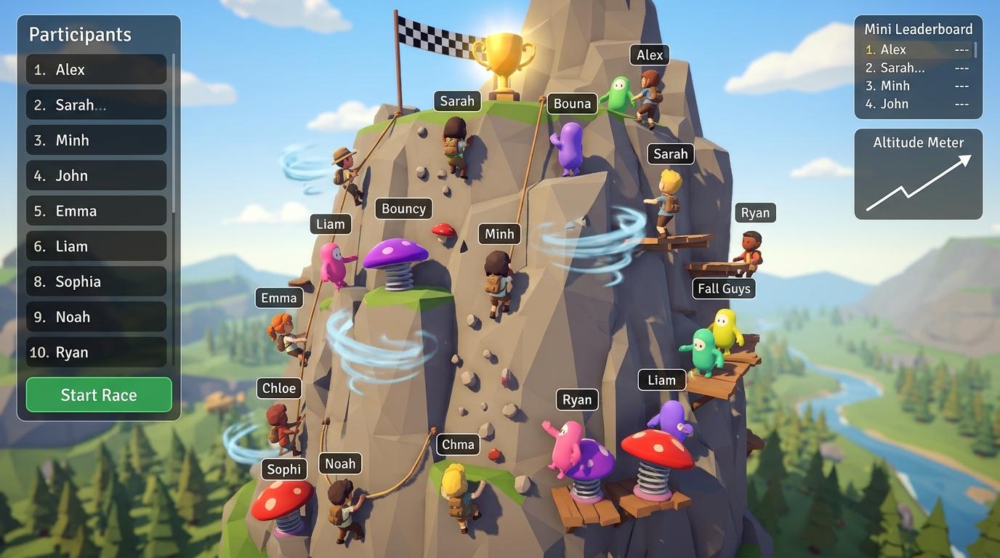

# 🏔️ Cuộc Đua Leo Núi 3D (3D Mountain Climbing Race)

Một tựa game quay số / đua ngẫu nhiên vui nhộn (tương tự **Random Duck Race - Đua Vịt**) chạy trực tiếp trên trình duyệt bằng **Three.js 3D** và sẵn sàng **deploy 100% miễn phí lên GitHub Pages**.



---

## ✨ Điểm nổi bật

- **Bản đồ 3D Leo Núi:** Vách núi đá hùng vĩ cao 350m với nấm nhún lò xo (bật vọt lên), luồng gió xoáy (thổi bạt), và đá lở ngẫu nhiên (lùi bước).
- **Hỗ trợ từ 5 đến 500+ người cùng lúc:** Tối ưu hiệu năng 60 FPS mượt mà.
- **Bảng tên 3D (Name Tags):** Tên từng người bay lơ lửng trên đầu nhân vật, phân biệt bằng màu sắc rực rỡ riêng.
- **Hệ thống Camera thông minh:**
  - 🎥 **Bám Top 1:** Tự động lia theo người đang dẫn đầu.
  - 🌄 **Toàn cảnh:** Ngắm toàn bộ ngọn núi và hàng trăm người đang leo.
  - 🎮 **Tự do:** Dùng chuột xoay 360 độ và phóng to thu nhỏ.
  - 🎯 **Theo dõi cá nhân:** Bấm vào bất kỳ tên ai trong bảng xếp hạng để camera bay đến người đó.
- **Bục vinh danh & Pháo hoa:** Vinh danh Top 1 (🥇), Top 2 (🥈), Top 3 (🥉) với hiệu ứng pháo hoa rực rỡ và nút sao chép toàn bộ bảng điểm để lưu trữ.
- **Âm thanh tổng hợp (Web Audio API):** Không cần tải file MP3 nặng, âm thanh nảy tưng, tiếng gió, còi đếm ngược tự động phát sinh siêu nhẹ.

---

## 🚀 Hướng Dẫn Chạy Thử Trên Máy (Local)

1. Mở terminal tại thư mục `E:\VOC\RandomRace`:
   ```bash
   npm install
   npm run dev
   npm.cmd run dev
   ```
2. Mở đường link hiển thị trên màn hình (thường là `http://localhost:5173`) trên trình duyệt để trải nghiệm ngay.

---

## 🌐 Hướng Dẫn Đưa Lên GitHub Pages (Miễn Phí 100%)

Dự án đã tích hợp sẵn GitHub Actions (`.github/workflows/deploy.yml`). Bạn chỉ cần:

1. **Khởi tạo Git và đẩy lên GitHub:**

   ```bash
   git init
   git add .
   git commit -m "Initial 3D Mountain Climbing Race"
   git branch -M main
   git remote add origin https://github.com/TÊN_GITHUB_CỦA_BẠN/RandomRace.git
   git push -u origin main
   ```

2. **Kích hoạt GitHub Pages:**
   - Vào repository trên GitHub $\rightarrow$ chọn **Settings** $\rightarrow$ **Pages** (ở cột bên trái).
   - Ở mục **Build and deployment > Source**, chọn **GitHub Actions**.
   - Chờ khoảng 1 phút, bạn sẽ nhận được đường link chơi game online chia sẻ cho mọi người: `https://TÊN_GITHUB_CỦA_BẠN.github.io/RandomRace/`!
